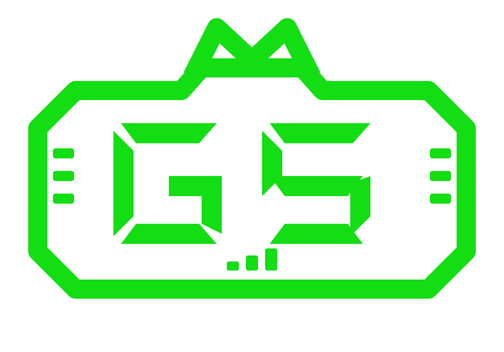

<p align="center">
  
</p>

# GwapScore Backend

This directory contains the executable backend for **GwapScore v2**, GWAP's social-reputation-first, multidimensional reputation system.

> Canonical product behavior is defined by [`../GWAPSCORE_V2_FOUNDATION_FREEZE.md`](../GWAPSCORE_V2_FOUNDATION_FREEZE.md), [`../GWAPSCORE_REPUTATION_MODEL_V2.md`](../GWAPSCORE_REPUTATION_MODEL_V2.md), and [`../GWAP-MASTER.md`](../GWAP-MASTER.md). Older protocol code remains for compatibility/history and is not the production v2 scoring contract.

## Current model

Candidate model version: **`2.0.0-alpha.2`**  
Production status: **not activated**  
Public score range: **300–900**

The v2 composite preserves four independently explainable dimensions:

| Dimension | Current candidate weight | Status |
| --- | ---: | --- |
| Social Reputation | 45% | Alpha |
| Wallet Reputation | 30% | Alpha |
| Identity / Proof | 15% | Alpha |
| GWAP Ecosystem Reputation | 10% | Reserved / unavailable until trusted adapters are connected |

The weights above are calibration candidates, not permanent protocol law.

### Core scoring rules

- Missing evidence is `unavailable`; it is not converted to `0` or a neutral `50`.
- Coverage and confidence are separate from the headline score.
- Material evidence retains provenance and an explanation.
- Wallet balances, market value, token-price volatility, concentration, drawdown, and net worth do not create reputation points.
- Wallet Reputation requires verified wallet control.
- A strong dimension may improve the composite but cannot erase a weak dimension.
- GwapScore never consumes another GwapScore as an input to itself.
- Same eligible evidence + same model version must produce the same result.

Current reputation tiers:

| Score | Tier |
| ---: | --- |
| 300–499 | Emerging |
| 500–599 | Developing |
| 600–699 | Established |
| 700–799 | Strong |
| 800–900 | Elite |

## v2 pipeline

```text
Consented / authorized evidence sources
        ↓
proof + provenance verification
        ↓
source-specific normalization
        ↓
Social / Wallet / Identity / Ecosystem dimensions
        ↓
confidence-weighted deterministic composition
        ↓
300–900 GwapScore + dimensions + coverage + confidence + explanations
```

## Social reputation

The social module supports user-consented account linking, metric ingestion, explicit evidence-state handling, and explainable social scoring.

Eligible evidence can include:

- proof-of-control of a supported account;
- account authenticity indicators;
- longitudinal account history;
- engagement quality;
- consistency and recency;
- audience trust signals;
- manipulation/anomaly indicators;
- approved public reputation events.

Historical rows created under the older neutral-imputation policy must be re-ingested before they are eligible for v2 composition.

### Social OAuth setup

Configure supported platform OAuth credentials in `.env`. For Instagram, the implementation expects values such as:

```dotenv
INSTAGRAM_CLIENT_ID=your_instagram_app_id
INSTAGRAM_CLIENT_SECRET=your_instagram_app_secret
INSTAGRAM_REDIRECT_URI=http://localhost:3000/v1/social/oauth/callback
SOCIAL_OAUTH_STATE_SECRET=<at least 32 random bytes>
SOCIAL_TOKEN_ENCRYPTION_KEY=<base64-encoded 32 random bytes>
```

Generate strong application secrets with a cryptographically secure generator such as `openssl rand -base64 32`.

The callback uses signed, expiring OAuth state and stored access tokens are encrypted. Only use platform-approved scopes and comply with each platform's review, privacy, and retention requirements.

## Wallet Reputation

Wallet Reputation consumes **reputation-eligible Wallet Intelligence**, not portfolio-risk or wealth data.

Current alpha evidence includes:

- verified wallet control;
- wallet longevity;
- transaction-history depth.

The privileged Solana adapter writes eligible evidence to dedicated Wallet Intelligence snapshots. Generic profile claims are retained only for backwards compatibility and are not authoritative v2 Wallet Reputation inputs.

The current `ownershipVerified` adapter assertion is an **alpha trust boundary**. It must be replaced/bound to authoritative GwapOS wallet Proof-of-Control before production activation.

## Identity / Proof

Current alpha proof classes include:

- connected social OAuth / proof-of-control;
- verified wallet control from eligible Wallet Intelligence.

Missing proof reduces evidence coverage/confidence rather than inventing a negative reputation score.

## GWAP Ecosystem Reputation

The ecosystem dimension is reserved for explicitly approved GWAP-native facts, such as future trusted PPV/GWAP evidence.

Generic user-submitted events must not silently become ecosystem reputation.

## API

Base URL in local development:

```text
http://localhost:3000/v1
```

Most endpoints require an API key:

```text
Authorization: Bearer YOUR_API_KEY
```

### v2 reputation

```text
GET /v1/reputation/me
```

Returns the authenticated user's v2 composite result, including model version, status, score, tier, coverage, confidence, per-dimension results, provenance/explanations, and unavailable evidence.

### Social

Representative user-scoped endpoints include:

```text
POST   /v1/social/accounts/connect
GET    /v1/social/accounts
POST   /v1/social/accounts/:accountId/ingest
GET    /v1/social/scores/latest
GET    /v1/social/scores/history
DELETE /v1/social/accounts/:accountId
DELETE /v1/social/data
```

### Solana adapter

```text
POST /v1/adapters/solana/evidence
```

This is a privileged adapter path. A Wallet Intelligence snapshot with unverified ownership contributes no Wallet Reputation.

### System

```text
GET /v1/system/health
GET /v1/system/version
```

Legacy profile/scoring routes may still exist for compatibility. Do not treat legacy 0–100 scoring output as the v2 GwapScore contract.

## Repository layout

```text
gwap-score-full/
├── api/                       # REST API and middleware
├── adapters/                  # External evidence adapters
├── core-engine/               # Trust-profile engine
├── database/                  # PostgreSQL schema, migrations, client
├── protocol/                  # Legacy/current protocol artifacts
├── reputation/
│   ├── composite.ts           # Deterministic v2 composite engine
│   ├── walletIntelligence.ts  # Wallet evidence normalization/persistence
│   └── service.ts             # Social + wallet + identity composition
├── social/                    # Social proof, ingestion, scoring
├── __tests__/                 # Regression and invariant tests
├── deployment/                # Container/deployment configuration
└── utils/                     # Crypto, validation, errors, logging
```

## Quick start

### Requirements

- Node.js 20+
- PostgreSQL 14+
- npm
- Docker / Docker Compose optional

### Install and build

```bash
git clone https://github.com/gwapupward-hub/GwapScore-Official-v1.git
cd GwapScore-Official-v1/gwap-score-full
npm ci
cp .env.example .env
npm run build
```

Apply the repository's current schema/migrations to your development database before starting the API.

### Run

```bash
npm start
```

### Test

```bash
npm test
npm test -- --coverage
npm run lint
npx tsc --noEmit
```

Critical v2 regression coverage includes the composite model and foundation invariants.

## Security boundaries

- API inputs must be validated.
- Database access uses parameterized queries.
- OAuth and API credentials must never be exposed in score responses.
- Private messages, passwords, secrets, and unnecessary raw wallet history are not scoring outputs.
- Wallet control must be cryptographically bound before production Wallet Reputation is enabled.
- Public/B2B score surfaces should expose only the evidence detail permitted by their contract.

## Foundation freeze

The v2 architecture is frozen under `GWAPSCORE-V2-FREEZE-001`.

Frozen architecture includes the product definition, four dimensions, 300–900 range, evidence states, coverage/confidence semantics, deterministic composition, explainability, Wallet Intelligence boundary, Proof-of-Control requirement, anti-circularity, result states, and version discipline.

Calibration remains open for candidate dimension weights, wallet submodel anchors, promotion thresholds, social factor weights, anomaly-confidence policy, and future ecosystem factors.

## Next engineering milestone

**Authoritative Wallet Proof-of-Control through GwapOS.**

The production flow must:

1. issue a short-lived challenge bound to subject + wallet + nonce + expiry;
2. obtain the wallet signature;
3. verify the signature server-side;
4. reject replay, stale challenges, and subject swapping;
5. persist the verified control relationship;
6. only then mark Wallet Intelligence as reputation-eligible.

## Production gates

Do not promote GwapScore v2 to production until:

1. authoritative wallet Proof-of-Control is complete;
2. CI/database/security regression validation passes;
3. representative real-data score distributions are evaluated;
4. candidate weights are calibrated;
5. Sybil/manipulation/adversarial cases are tested;
6. wallet-switch/primary-wallet policy is tested;
7. explanation/reason-code behavior is validated;
8. rollout and rollback are documented;
9. the production model version is explicitly approved.

## License

MIT — see [`../LICENSE`](../LICENSE).
